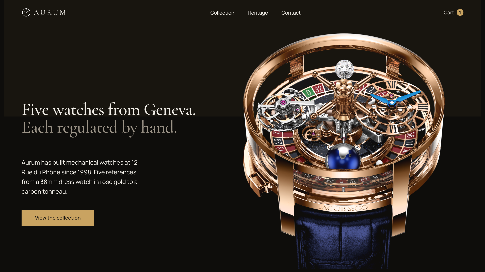

# Aurum

A multi-page e-commerce site for a fictional Geneva watch house. Dark, gold-accented
and built entirely with vanilla HTML, CSS and JavaScript, with no frameworks or build tools.



## Features

- **Data-driven pages:** every product is rendered from `products.json` via `fetch()`
- **Collection filter:** filter the five references by category
- **Reference picker:** choose a watch on the homepage and see it swap inside the disc
- **Product pages:** read from the URL (`product.html?id=meridian`) with an image gallery
- **Shopping cart:** stored in `localStorage`, with quantities, removal, live totals and a header count on every page
- **Live boutique clock:** shows the current time in Geneva and whether the boutique is open
- **Mobile navigation:** slide-down panel with scroll lock, closes on Escape
- **Motion:** scroll reveals via `IntersectionObserver`, scroll-linked image drift, with a full `prefers-reduced-motion` fallback

## Tech stack

- HTML5, CSS3 (custom properties, grid, `clip-path`, scroll-driven animations)
- Vanilla JavaScript (ES6+, Fetch API, `localStorage`, `Intl` API)
- Self-hosted fonts: Cormorant Garamond and Manrope

## Project structure

```
index.html          Homepage
html/               Collection, product, cart, heritage and contact pages
css/                Design tokens, reset and fonts
style.css           Page styles
script.js           Page logic (rendering, filter, cart page, navigation)
script/             Helpers, templates, product fetch and cart storage
products.json       Product data
```

## Run locally

Because the pages load `products.json` with `fetch()`, they need a local server:

```bash
python3 -m http.server
```

Then open http://localhost:8000.

## Note

Aurum and its five references are fictional. The product photographs belong to their
respective watch brands and photographers and are used here for a non-commercial
portfolio project only.
